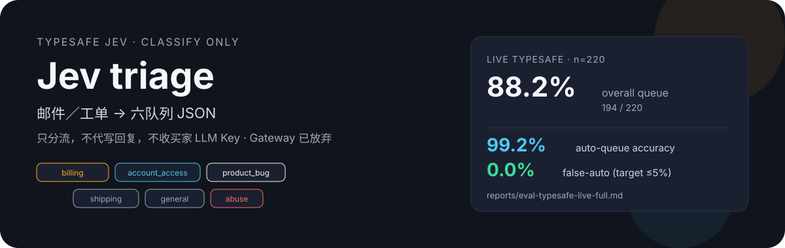
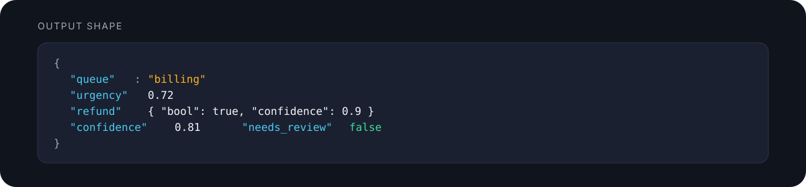

# Jev triage

<p align="center">
  
</p>

本地 MVP：**邮件／工单 → 结构化 JSON 分流**。只分类，不代写客服回复，不收集买家 LLM Key。

生产／自用只走 **TypeSafe 直连**（环境变量 `TYPESAFE_API_KEY`）。**Gateway 已放弃**（`adapters/gateway/` 保留但不维护）。

## 证明（真实评测）

来源：`reports/eval-typesafe-live-full.md`（live / TypeSafe，`samples.jsonl`，**n=220**）

| 指标 | 结果 | 目标 |
|------|------|------|
| Overall queue accuracy | **88.2%**（194/220） | — |
| Auto-queue accuracy（`needs_review=false`） | **99.2%**（118/119） | ≥ 80% |
| False-auto（金标需人工却被自动） | **0.0%**（0/47） | ≤ 5% |

Dry／heuristic 同集：overall 81.4%、auto-queue 84.2%、false-auto 0.0%（见 `reports/eval-latest.md`）。

<p align="center">
  
</p>

## 六队列（固定）

| queue | when |
|-------|------|
| `billing` | 扣款、发票、订阅、退款 |
| `account_access` | 登录、密码、2FA、锁定、SSO |
| `product_bug` | 崩溃、缺陷、回归、报错 |
| `shipping` | 物流、丢件、错件、履约 |
| `general` | 用法、功能请求、非紧急不清 |
| `abuse` | 骚扰、欺诈、ToS、安全 |

## 输出 JSON

```json
{
  "queue": "billing",
  "urgency": 0.72,
  "refund": { "noul": 0.88, "bool": true, "confidence": 0.9 },
  "escalate": { "noul": 0.12, "bool": false, "confidence": 0.8 },
  "confidence": 0.81,
  "needs_review": false
}
```

低置信：`confidence` 低于阈值 → `needs_review=true`（验收表与报告以仓库配置／评测为准）。

## Backend

| backend | when | notes |
|---------|------|-------|
| **TypeSafe Python SDK** `system_one` | 已设 `TYPESAFE_API_KEY` | 当前主路径 |
| **dry / heuristic** | `--dry-run` 或无 Key | 离线关键词，评测 smoke |
| Vercel AI Gateway | — | **已放弃**；代码留在 `adapters/gateway/` |

## Setup & classify

```bash
# 确保 Node／venv 在 PATH 中；TYPESAFE_API_KEY 已在环境（不要打印）
cd /path/to/jev-triage

python scripts/classify_cli.py --dry-run "I was charged twice, please refund."
python scripts/classify_cli.py --live "I was charged twice, please refund."
echo "无法登录，密码重置邮件收不到" | python scripts/classify_cli.py --dry-run
```

## Eval

```bash
python scripts/eval.py --dry-run --limit 20
python scripts/eval.py --all --dry-run
python scripts/eval.py --live --limit 10
python scripts/eval.py --live --limit 200
```

报告：`reports/eval-latest.md`（及 `eval-typesafe-live-full.md` 等）。

样本：`data/samples.jsonl`（≥200 条中英合成／公开风格工单，已脱敏）。再生：`python scripts/gen_samples.py`。

## 目录

```text
config.yaml
src/classify.py
scripts/classify_cli.py  eval.py  gen_samples.py
data/samples.jsonl
reports/
adapters/gateway/          # abandoned
TASK.md
```

## Not in scope

自动回复、Zendesk、代持 ChatGPT/Claude Key、公开仓、Fast 模型。
